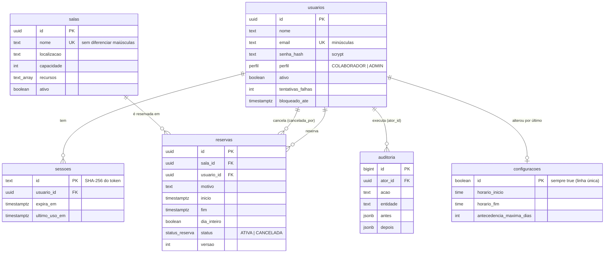

# Banco de dados

O sistema usa um banco **PostgreSQL** (no Supabase). Todas as tabelas ficam no schema
**`reserva`**, que não é exposto pela Data API do Supabase: somente a API deste projeto lê e grava
os dados.

| Arquivo                                                           | Para que serve                                                      |
| ----------------------------------------------------------------- | ------------------------------------------------------------------- |
| [`database/supabase.sql`](../database/supabase.sql)               | Estrutura completa (tabelas, regras, índices). Colar no SQL Editor. |
| [`database/papel-aplicacao.sql`](../database/papel-aplicacao.sql) | Cria o usuário `reserva_app`, de permissões mínimas (produção).     |
| [`database/papel-backup.sql`](../database/papel-backup.sql)       | Cria o usuário `reserva_backup`, só de leitura (backup no GitHub).  |
| [`database/consultas-uteis.sql`](../database/consultas-uteis.sql) | Consultas somente leitura para o administrador.                     |
| `apps/api/src/db/migrations/*.sql`                                | Origem da estrutura. O `supabase.sql` é gerado a partir delas.      |

## Diagrama



Datas e horas são gravadas como `timestamptz` (instante absoluto, em UTC). A interface exibe e o
servidor valida no fuso **America/Sao_Paulo**.

## Tabelas

### `usuarios`

| Coluna                       | Tipo        | Observação                                                                  |
| ---------------------------- | ----------- | --------------------------------------------------------------------------- |
| `id`                         | uuid        | Gerado pelo banco.                                                          |
| `nome`                       | text        | 2 a 120 caracteres.                                                         |
| `email`                      | text        | Único, sempre em minúsculas, formato validado.                              |
| `senha_hash`                 | text        | Hash **scrypt** com sal. A senha nunca é gravada.                           |
| `perfil`                     | enum        | `COLABORADOR` (padrão) ou `ADMIN`.                                          |
| `ativo`                      | boolean     | Usuário desativado não entra no sistema; o histórico é preservado.          |
| `tentativas_falhas`          | int         | Zerado no login certo. 5 falhas → bloqueio.                                 |
| `bloqueado_ate`              | timestamptz | Fim do bloqueio atual (1, 2, 4, 8 ou no máximo 15 minutos).                 |
| `bloqueios_seguidos`         | int         | Bloqueios em sequência; define a duração do próximo. Zerado no login certo. |
| `ultimo_login_em`            | timestamptz |                                                                             |
| `ativado_em`                 | timestamptz | Criação ou última reativação. Com `ultimo_login_em`, conta os dias sem uso. |
| `senha_alterada_em`          | timestamptz | Trocar a senha encerra as outras sessões.                                   |
| `criado_em`, `atualizado_em` | timestamptz | `atualizado_em` é atualizado por trigger.                                   |

### `sessoes`

| Coluna             | Tipo        | Observação                                                    |
| ------------------ | ----------- | ------------------------------------------------------------- |
| `id`               | text        | **Hash SHA-256** do token. O token em si existe só no cookie. |
| `usuario_id`       | uuid        | Apagar o usuário apaga as sessões (o sistema só desativa).    |
| `expira_em`        | timestamptz | Renovado a cada uso, até `SESSION_IDLE_MINUTES` sem uso.      |
| `ultimo_uso_em`    | timestamptz |                                                               |
| `ip`, `user_agent` | text        | Registrados para consulta em caso de investigação.            |
| `criado_em`        | timestamptz | Limite absoluto: `SESSION_MAX_HOURS` desde o login.           |

Sessões vencidas são apagadas automaticamente pela API.

### `salas`

| Coluna        | Tipo    | Observação                                                     |
| ------------- | ------- | -------------------------------------------------------------- |
| `nome`        | text    | 1 a 80 caracteres; único sem diferenciar maiúsculas e espaços. |
| `localizacao` | text    | Andar/bloco, até 120 caracteres.                               |
| `capacidade`  | int     | 1 a 1000.                                                      |
| `recursos`    | text[]  | Ex.: `{Televisão,Projetor}`.                                   |
| `descricao`   | text    | Opcional, até 1000 caracteres.                                 |
| `ativo`       | boolean | Sala desativada não aceita novas reservas.                     |

### `reservas`

| Coluna                                                 | Tipo        | Observação                                                               |
| ------------------------------------------------------ | ----------- | ------------------------------------------------------------------------ |
| `sala_id`, `usuario_id`                                | uuid        | Não podem ser apagados enquanto houver reservas (`on delete restrict`).  |
| `motivo`                                               | text        | 3 a 200 caracteres.                                                      |
| `participantes`                                        | int         | Opcional, 1 a 1000.                                                      |
| `inicio`, `fim`                                        | timestamptz | `fim > inicio`. Intervalo fechado no início e aberto no fim.             |
| `dia_inteiro`                                          | boolean     | Ocupa todo o horário de funcionamento do dia.                            |
| `status`                                               | enum        | `ATIVA` ou `CANCELADA`. Reservas nunca são apagadas.                     |
| `cancelada_em`, `cancelada_por`, `motivo_cancelamento` |             | Preenchidos ao cancelar.                                                 |
| `versao`                                               | int         | Aumenta a cada edição: impede que duas pessoas sobrescrevam uma à outra. |

### `auditoria`

Histórico do que muda no sistema: reservas (criação, alteração, cancelamento), salas, usuários,
senhas, configurações, tentativas de login com falha e bloqueios de conta. `acao` (ex.:
`RESERVA_CANCELADA`), `entidade` e `entidade_id`
dizem o que mudou; `antes` e `depois` guardam os valores (nunca senhas nem hashes); `ator_id` e
`ip` dizem quem e de onde. **Não pode ser alterada nem apagada** (trigger `auditoria_imutavel`).

### `configuracoes`

Uma única linha (`id = true`), alterada em **Administração → Configurações**.

| Coluna                             | Padrão        | Limites                        |
| ---------------------------------- | ------------- | ------------------------------ |
| `horario_inicio` / `horario_fim`   | 07:00 / 20:00 | fim depois do início           |
| `granularidade_minutos`            | 15            | 5, 10, 15, 30 ou 60            |
| `duracao_minima_minutos`           | 15            | ≥ 5                            |
| `duracao_maxima_minutos`           | 480           | ≥ mínima e ≤ 1440              |
| `antecedencia_maxima_dias`         | 120           | 1 a 730                        |
| `intervalo_entre_reunioes_minutos` | 0             | 0 a 60                         |
| `motivo_visivel_para_todos`        | sim           |                                |
| `desativar_apos_dias_sem_login`    | 60            | 15 a 365, ou vazio (desligado) |

Com `desativar_apos_dias_sem_login`, o servidor desativa (de hora em hora e no login) os
**colaboradores** que não entram há mais dias que o configurado. Administradores nunca são
desativados por este motivo. As sessões são encerradas, as reservas futuras são mantidas e o
histórico registra **Usuário desativado por falta de uso**. Reativar a pessoa recomeça a contagem.

### `migracoes`

Controle das migrações aplicadas: `nome`, `checksum` (SHA-256 do arquivo) e `aplicada_em`. Se um
arquivo de migração já aplicado for alterado, `db:migrate` e `supabase.sql` param com erro.

## Regras garantidas pelo próprio banco

Mesmo que a API tivesse um defeito, o banco recusa:

1. **Reservas sobrepostas**: a restrição `reservas_sem_conflito` (`exclude using gist`) impede
   duas reservas **ativas** da mesma sala com horários sobrepostos — inclusive quando duas pessoas
   clicam ao mesmo tempo. Reservas encostadas (10h–11h e 11h–12h) são permitidas.
2. Período inválido (`fim <= inicio`), textos vazios ou longos demais, capacidade fora do limite.
3. E-mail repetido ou com maiúsculas; nome de sala repetido.
4. Reserva cancelada sem data de cancelamento (e vice-versa).
5. Apagar salas ou usuários que tenham reservas ou histórico.
6. Alterar ou apagar o histórico (auditoria).
7. Mais de uma linha de configurações.

As demais regras (horário de funcionamento, antecedência, duração, intervalo entre reuniões,
quem pode editar o quê) são validadas na API, que é o único caminho de acesso aos dados.

## Segurança do banco

- **RLS ligado** em todas as tabelas. Sem políticas, nenhum papel além do dono lê nada.
- Os papéis públicos do Supabase (`anon`, `authenticated`) não têm nenhuma permissão no schema
  `reserva`. Mesmo assim, **desligue a Data API** (veja [INSTALACAO.md](INSTALACAO.md)).
- Senhas: só o hash scrypt. Sessões: só o hash do token.

## Usuário da aplicação (`reserva_app`)

Por padrão a API conecta como `postgres`, o dono de tudo. Em produção, recomenda-se um usuário com
**permissões mínimas**: se a senha da aplicação vazar ou houver um defeito, ele **não consegue**
apagar tabelas, apagar reservas ou usuários, alterar o histórico nem desligar as proteções.

| Tabela                                           | `reserva_app` pode                   |
| ------------------------------------------------ | ------------------------------------ |
| `usuarios`, `salas`, `reservas`, `configuracoes` | ler, inserir, alterar (nunca apagar) |
| `sessoes`                                        | ler, inserir, alterar, apagar        |
| `auditoria`                                      | ler e inserir                        |
| `migracoes`                                      | só ler                               |

### Passo a passo

1. Crie as tabelas antes (`database/supabase.sql` ou `npm run db:migrate`).
2. Gere uma senha forte, **só com letras e números**, com 24 caracteres ou mais (ex.: no
   gerenciador de senhas). Guarde-a.
3. Supabase → **SQL Editor → New query** → cole o conteúdo de `database/papel-aplicacao.sql`.
4. **No SQL Editor** (nunca no arquivo do projeto, que vai para o GitHub), na linha
   `senha text := 'TROQUE-ESTA-SENHA';`, troque pelo valor gerado. **Run**.
   O resultado lista as permissões de cada tabela. Não salve a consulta com a senha no Supabase
   (feche a aba sem salvar).
5. No `.env` do servidor:

   ```dotenv
   # Servidor: usuário de permissões mínimas (repare no ".<id-do-projeto>" depois do nome)
   DATABASE_URL=postgresql://reserva_app.<id-do-projeto>:<senha-do-reserva_app>@<host-do-pooler>:5432/postgres
   # Só para db:setup, db:migrate e db:restaurar (estrutura e restauração)
   DATABASE_MIGRATION_URL=postgresql://postgres.<id-do-projeto>:<senha-do-postgres>@<host-do-pooler>:5432/postgres
   ```

   O `<id-do-projeto>` e o `<host-do-pooler>` são os mesmos da URL do `postgres` (botão
   **Connect → Session pooler**). No pooler do Supabase o nome do usuário leva o id do projeto
   depois do ponto.

6. Reinicie a API e abra o sistema. A tela inicial deve mostrar o banco **Conectado**.

Para trocar a senha do `reserva_app`, execute o arquivo de novo com a nova senha e atualize o
`.env`. Depois de uma **nova migração** que crie tabelas, execute-o de novo para conceder as
permissões nas tabelas novas.

Se o servidor mostrar `password authentication failed for user "reserva_app"`, confira a senha e o
`.<id-do-projeto>` no nome do usuário. Se mostrar `permission denied`, execute de novo o
`papel-aplicacao.sql`.

## Gerar de novo o `supabase.sql`

O arquivo é gerado a partir das migrações; nunca o edite à mão. Ao criar uma migração nova
(`apps/api/src/db/migrations/0003_....sql`):

```powershell
npm run db:sql     # atualiza database/supabase.sql
npm run check      # um teste confere se o arquivo está em dia com as migrações
```

Nunca altere uma migração que já foi aplicada em algum banco: crie outra.

## Consultas úteis

O arquivo [`database/consultas-uteis.sql`](../database/consultas-uteis.sql) tem consultas
**somente leitura** para usar no SQL Editor: reservas de hoje, uso das salas nos últimos 30 dias,
quem mais reservou, histórico de uma reserva, administradores ativos, contas bloqueadas, sessões
abertas, tamanho das tabelas e migrações aplicadas.

Evite alterar dados diretamente pelo SQL Editor: a alteração não passa pelas regras da API nem
fica registrada no histórico. Use a interface do sistema.

## Backup e restauração

### Backups do próprio Supabase

- **Plano gratuito:** **não há backup automático**. O Supabase recomenda exportar os dados por
  conta própria — é o que o `npm run db:backup` faz.
- **Planos pagos (Pro em diante):** backup diário automático, restaurável pelo painel em
  **Database → Backups** (a retenção depende do plano). A restauração pelo painel volta o
  **projeto inteiro** para aquele dia e deixa o projeto indisponível durante o processo.
- **Point-in-Time Recovery (PITR):** complemento pago que restaura para um minuto específico.

Mesmo num plano pago, mantenha também o backup próprio: ele fica sob seu controle, fora do
Supabase, e é restaurável em qualquer outro PostgreSQL.

### Backup do sistema (`npm run db:backup`)

```powershell
npm run db:backup                           # salva em backups\reserva-AAAA-MM-DD-HHMM.sql
npm run db:backup -- D:\backups\reserva.sql # ou em outro caminho
```

- Contém **usuários (com o hash das senhas), salas, reservas, histórico e configurações**. Não
  contém sessões: após restaurar, todos entram de novo.
- A leitura é feita num instante único (consistente), sem parar o sistema.
- **Contém dados pessoais**: guarde em local protegido (pasta com acesso restrito, disco
  criptografado) e não envie por e-mail.
- Não contém a estrutura: ela vem das migrações.

### Restaurar (`npm run db:restaurar`)

```powershell
# Banco novo e vazio (ex.: um projeto Supabase novo, após o supabase.sql ou db:migrate):
npm run db:restaurar -- backups\reserva-2026-10-11-0200.sql

# Banco com dados: apaga TUDO o que existe e coloca o conteúdo do backup.
npm run db:restaurar -- backups\reserva-2026-10-11-0200.sql --substituir
```

- Com `--substituir`, o comando pede para digitar `SUBSTITUIR` antes de apagar os dados.
- Tudo acontece numa única transação: se algo falhar, o banco fica exatamente como estava.
- O comando recusa um arquivo que não seja backup deste sistema, um banco sem as migrações do
  backup e um backup de uma versão mais nova do sistema.
- Usa `DATABASE_MIGRATION_URL`, se definida (o `reserva_app` não tem permissão para apagar).
- Depois de restaurar com `--substituir`, todos precisam entrar de novo.

**Teste a restauração** periodicamente num projeto separado (por exemplo o de testes): um backup
que nunca foi restaurado não é garantia. Veja a rotina em [MANUTENCAO.md](MANUTENCAO.md).

### Alternativa: cópia completa com `pg_dump`

Para uma cópia completa (estrutura e dados) com as ferramentas do PostgreSQL ou da CLI do
Supabase (`supabase db dump`), use a URL do `postgres`. É útil para migrar para outro servidor
PostgreSQL, mas a restauração exige mais cuidado; para o dia a dia, prefira o `db:backup`.
